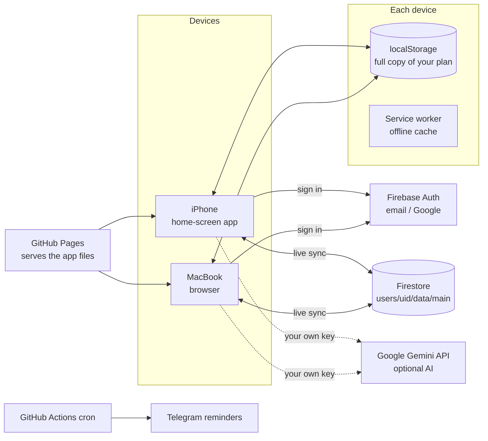

# 🐸 Frog Pond

**A free, private, offline-first daily planner built on the ideas in *Eat That Frog!* by Brian Tracy.**

Live app: **https://dheerajd9.github.io/frog-pond/**

Frog Pond turns the book's 21 rules into a daily habit: pick your hardest, most important job (your "frog"), do it first thing every morning, and plan tomorrow tonight. It runs in any browser, installs on the iPhone home screen like an app, works with no internet, and syncs between the iPhone and the MacBook for free.

> Personal project. Not affiliated with or endorsed by Brian Tracy or his publisher. The rules are retold in my own simple words; no text from the book is copied.

---

## Table of contents

1. [Why I built it](#1-why-i-built-it)
2. [What it does](#2-what-it-does)
3. [How each rule in the book maps to the app](#3-how-each-rule-in-the-book-maps-to-the-app)
4. [How I built it: the project journey](#4-how-i-built-it-the-project-journey)
5. [Architecture](#5-architecture)
6. [How it works inside](#6-how-it-works-inside)
7. [Privacy and security](#7-privacy-and-security)
8. [Cost: why it is free](#8-cost-why-it-is-free)
9. [Set it up yourself](#9-set-it-up-yourself)
10. [How to use it every day](#10-how-to-use-it-every-day)
11. [Testing](#11-testing)
12. [Files in this repo](#12-files-in-this-repo)
13. [Limitations and roadmap](#13-limitations-and-roadmap)

---

## 1. Why I built it

After reading *Eat That Frog!* I saw that the whole book comes down to a few habits: write your goals, work from lists (master, monthly, weekly, daily), put a priority on every task, do the most important task first, and repeat it until it becomes automatic. Paper lists get lost, and most to-do apps don't follow this method. So I wanted an app that:

- follows the book exactly, chapter by chapter,
- is simple enough that even a 5-year-old could use it,
- costs nothing to run (no paid subscriptions, no paid servers),
- works on my iPhone, my MacBook or any browser, with the same data on all of them,
- keeps my data private.

## 2. What it does

| Area | What you get |
|---|---|
| **Easy mode** | A yellow **Do this now** card that always shows the single next step (add jobs → give letters → eat the frog → next job → plan tomorrow), a letter picker that explains A–E, a 6-step **plan-tomorrow wizard**, a welcome tour on first open (replay from Me → Settings) and a "How to use" box on every tab |
| **Today** | Your frog card (the A-1 task) with "Start eating" and "I ate my frog!", today's list with A/B/C/D/E letters, the 21-day habit tracker, daily habits, an evening "plan tomorrow" checklist and a "feeling stuck?" question box |
| **Lists** | Big list → Month → Week → Today, plus a "Not doing" list for creative procrastination. Tasks move down the chain with one tap |
| **Goals** | Up to 10 goals written as if already true, one starred major goal with a finish date, ordered steps, a "next oil barrel" marker and a "what is holding me back?" field |
| **Me** | Sync sign-in, key result areas scored 1–10 (the weakest one is flagged), the one-skill question, energy and talent questions, Gemini AI key, backup and restore |
| **21 Rules** | A rule of the day plus all 21 rules in simple words, each with a "Do it now" action and a button that jumps to the matching part of the app |
| **Focus timer** | A get-ready checklist, then 10 min (Swiss cheese), 30, 60 or 90 min blocks, with "I got distracted → Back to work!" |
| **AI helper (optional, free)** | Google Gemini slices a big task into small steps or lists the steps for a goal |
| **Sync (optional, free)** | Sign in with the same email on every device and changes show up on the others within seconds |
| **Reminders (optional, free)** | A GitHub Actions cron job sends a Telegram message every morning ("eat your frog") and every evening ("plan tomorrow") |

## 3. How each rule in the book maps to the app

| # | Rule (book chapter) | Where it lives in the app |
|---|---|---|
| 1 | Set the table | Goals tab: 10 goals in present tense, one starred major goal, the 7 goal steps, finish date |
| 2 | Plan every day in advance | Lists tab (Big → Month → Week → Today), "Tonight: plan tomorrow", weekend and month-end banners |
| 3 | Apply the 80/20 rule | Today shows how many of your tasks are the "vital few" (top 20%) |
| 4 | Consider the consequences | The "what happens if I do it / don't do it?" question when ordering A tasks and in the stuck box |
| 5 | ABCDE method | Tap-to-cycle letters on every task, A tasks numbered A-1, A-2, A-3, a warning when you finish a B/C task while an A is left |
| 6 | Key result areas | Me tab: 5–7 areas scored 1–10, weakest one flagged "work on this", the one-skill question |
| 7 | Law of forced efficiency | The three questions in "Feeling stuck? Ask these" |
| 8 | Prepare before you begin | "Have ready" list on every task, a get-ready checklist before the timer starts |
| 9 | Do your homework | Daily habit: learn in my field (aim for 1 hour) |
| 10 | Leverage your special talents | Me tab: talent questions |
| 11 | Identify your key constraints | "What is holding me back?" on every goal |
| 12 | One oil barrel at a time | The "next oil barrel" marker on the next undone goal step |
| 13 | Put the pressure on yourself | A deadline on any task with a "late" chip, the "leaving town for a month" question |
| 14 | Maximize your personal powers | Best time of day, weekly day off, bed by 10 pm habit, four energy questions |
| 15 | Motivate yourself into action | Self-talk bubble ("I like myself!", "I can do it!", "I feel terrific!") |
| 16 | Creative procrastination | "Not doing" list and the zero-based thinking question |
| 17 | Do the most difficult task first | Frog card, 21-day tracker, "Just for today" |
| 18 | Slice and dice the task | Salami slices on any task (by hand or with AI), the 10-minute Swiss cheese timer |
| 19 | Create large chunks of time | 30 / 60 / 90 minute focus blocks |
| 20 | Develop a sense of urgency | "Do it now!" in the self-talk bubble and the stuck box |
| 21 | Single handle every task | The focus timer's "I got distracted → Back to work!" button and "Finished it!" |

## 4. How I built it: the project journey

I built it in one long session with an AI assistant (Claude), as a series of steps. Each step solved a problem the step before had.

**Step 1: Read the whole book.** The PDF (103 pages) was turned into text and every chapter was read, including the "Putting It All Together" summary, so the app copies the book's method, not a general idea of it.

**Step 2: First version as a hosted page.** A first version was built as a single web page. On review it was missing much of the book: A-1/A-2 numbering, the 21-day habit, the get-ready list, the not-doing list, the 10-goals exercise, constraints, the three questions and the energy questions.

**Step 3: Rebuild to match all 21 chapters.** The app was rewritten so every chapter has a place (see the table above), and each rule card links to its feature.

**Step 4: Make it 100% free and independent.** Since I don't have a paid AI subscription, the app was moved off any paid platform and made into a standalone Progressive Web App (PWA):
- plain HTML, CSS and JavaScript in one file, no build step, no framework,
- saves to the device (localStorage), so it works with no account,
- a service worker for offline use, a manifest and icons so it installs on the iPhone home screen,
- the free Google Gemini API (your own key) instead of a paid AI,
- backup and restore through a JSON file.

**Step 5: Free hosting on GitHub Pages.** The files were pushed to this repo and GitHub Pages serves them at `dheerajd9.github.io/frog-pond`. The repo has to be public for free Pages; that is safe because the repo only holds code, never personal data.

**Step 6: Free reminders.** A GitHub Actions workflow (`reminders.yml`) runs on a cron schedule and sends Telegram messages with the bot I already use for other alerts.

**Step 7: Real sync between iPhone and MacBook.** Moving backup files by hand was too much work, so free sync was added with Firebase (Spark plan):
- Firebase Authentication (email + password, plus Google sign-in on desktop browsers),
- a Firestore database with rules that let each user read and write only their own document,
- an item-by-item merge so edits from two devices never erase each other,
- an optional passphrase lock that encrypts the data on the device before upload.

**Step 8: Security pass.** Secrets scan of the full history, input cleaning against injected HTML, two sync bugs fixed, least-privilege CI and a console security checklist (section 7).

**Step 9: Easy mode.** After real use showed it was confusing for a first-timer, guidance was added without removing anything: the "Do this now" card, the letter picker, the plan-tomorrow wizard, the welcome tour and per-tab help.

**Step 10: Set up and test on real devices.** The Firebase project was created and configured (sign-in methods, authorized domain, Firestore rules, web app config), the app was added to the iPhone home screen, and sync was turned on.

## 5. Architecture



- **Front end:** one `index.html` with vanilla JavaScript and inline CSS. Fonts come from Google Fonts. The only library is the Firebase JavaScript SDK (compat build 10.14.1), loaded from Google's CDN only when the device is online.
- **Hosting:** GitHub Pages (static files).
- **Back end:** none of my own. Firebase Authentication and Cloud Firestore do the work.
- **AI:** direct browser call to the Gemini `generateContent` endpoint with the user's own key.
- **Automation:** GitHub Actions scheduled workflow to the Telegram Bot API.

## 6. How it works inside

### 6.1 Data model

The whole plan is one JSON object:

```json
{
  "v": 2,
  "tasks": [{ "id": "…", "text": "Fix resume", "list": "day", "letter": "A", "rank": 1,
              "done": false, "due": "2026-10-20", "need": "Laptop, old resume",
              "slices": [{ "id": "…", "text": "Write summary", "done": false }], "u": 1760000000000 }],
  "goals": [{ "id": "…", "text": "I work as an MLOps Engineer", "major": true, "deadline": "",
              "blocker": "", "steps": [], "u": 1760000000000 }],
  "kra": [{ "id": "…", "name": "Planning", "score": 6, "u": 1760000000000 }],
  "frogLog": { "2026-10-19": "<task id>" },
  "habits":  { "2026-10-19": { "goal": true, "learn": true } },
  "plan":    { "2026-10-19": { "carry": true, "letters": true } },
  "answers": { "energy.more": "…" },
  "oneSkill": "", "bestTime": "morning", "dayOff": "Sunday",
  "tomb": { "<deleted id>": 1760000000000 },
  "updatedAt": 1760000000000
}
```

- `list` is one of `master`, `month`, `week`, `day`, `no`.
- `rank` numbers the A tasks; **A-1 on the day list is the frog**.
- `frogLog` records the day the frog was eaten; the streak and the 21-day tracker come from it.
- `u` is the time an item last changed; `tomb` remembers deleted items. Both exist for sync.
- Finished tasks older than 45 days and daily habit/plan entries older than 120 days are pruned, so the record stays small.

### 6.2 Saving and offline

Every change saves to `localStorage` on the device right away. That copy is what the app shows, so it opens instantly and works on a plane. The service worker caches the app files (network first, cache when offline). Firebase and Gemini calls skip the cache and go straight to the network.

### 6.3 Sync and merge

When you are signed in, the app listens to one Firestore document: `users/{uid}/data/main`.

1. **Change tracking:** after each change the app compares every task, goal and key area with the last saved version. Changed items get a new `u` time; removed items get a tombstone in `tomb`.
2. **Upload:** about 0.8 seconds after you stop tapping, the plan is uploaded (one write, not one per tap).
3. **Download:** when another device changes the document, the app gets it live and **merges**:
   - tasks, goals and key areas merge **item by item**; the newer `u` wins,
   - an item with a tombstone newer than its last change stays deleted,
   - daily habit and plan ticks merge key by key,
   - single settings take the newer document's value.
4. If the merged result differs from the cloud copy, it is uploaded again. The merge is deterministic and idempotent (merging the same data twice changes nothing), so devices settle quickly and never loop.

Example: offline, you edit task A and delete task B on the iPhone, and you add task D on the Mac. After both sync, all three changes are kept.

### 6.4 Optional extra lock (end-to-end encryption)

- You choose a passphrase (8+ characters). A 256-bit AES-GCM key is made from it with PBKDF2 (SHA-256, 250,000 rounds, random 16-byte salt).
- The plan is encrypted on the device with a fresh 12-byte IV on every upload. Firestore only ever stores `{ enc: true, salt, iv, data }`, which is unreadable without the passphrase.
- Each device asks for the passphrase once and keeps the derived key locally. The passphrase itself is never stored or uploaded.
- If the passphrase is forgotten, the synced copy cannot be decrypted. Each device still has its own local copy.

### 6.5 AI helper

With a free Gemini key saved in Me → Settings, the app sends a short prompt such as "break this task into 3–6 tiny steps…" to `generativelanguage.googleapis.com` with `responseMimeType: application/json` and adds the returned steps to the task or goal. The key is stored only in that device's localStorage, never in the repo and never in sync.

### 6.6 Reminders

`.github/workflows/reminders.yml` runs at `0 11 * * *` and `0 1 * * *` UTC: 7 am and 9 pm New York time in summer, one hour earlier in winter. It posts a message to the Telegram Bot API using the repo secrets `TELEGRAM_BOT_TOKEN` and `TELEGRAM_CHAT_ID`, and skips quietly if they are not set. It can also be run by hand from the Actions tab.

## 7. Privacy and security

- **Firestore rules:** only the signed-in owner can read or write their own single document, and only the fields the app uses are accepted:
  ```
  rules_version = '2';
  service cloud.firestore {
    match /databases/{database}/documents {
      match /users/{uid}/data/main {
        allow read, delete: if request.auth != null && request.auth.uid == uid;
        allow create, update: if request.auth != null && request.auth.uid == uid
          && request.resource.data.keys().hasOnly(['v','enc','json','salt','iv','data','updatedAt']);
      }
    }
  }
  ```
- **The Firebase web config in `index.html` is public by design.** It only names the project; the security comes from the rules above and the authorized-domain list in Firebase Authentication.
- **No personal data in this repo.** Tasks, goals and answers live only on the devices and in your own Firebase project.
- **Secrets** (Telegram token, chat ID) are GitHub Actions secrets, hidden even in a public repo. The Gemini key never leaves the device.
- **Shared computer?** Me → "Sign out and remove data from this device" (also removes the Gemini key and settings from that device).
- **Input hardening:** everything loaded from storage, sync or a backup file is checked and cleaned (ids limited to letters, digits, `-` and `_`; text length capped; unknown values reset), and all user text is HTML-escaped before display, so a bad backup file cannot inject code.
- **Least privilege in CI:** the reminder workflow runs with `permissions: {}` and a 2-minute timeout.

### Security checklist (do once in the Firebase / Google Cloud console)

1. **Turn off public sign-ups** after creating your own account: Firebase → Authentication → Settings → User actions → untick **Enable create (sign-up)**. Strangers then can't make accounts and use your free quota.
2. **Lock the web API key to your site:** console.cloud.google.com → project *frog-pond* → APIs & Services → Credentials → *Browser key (auto created by Firebase)* → Application restrictions: **Websites** → add `https://dheerajd9.github.io/*` and `https://frog-pond-74a4a.firebaseapp.com/*` → Save.
3. **Keep email enumeration protection on:** Authentication → Settings → User actions (on by default for new projects).
4. Stay on the **Spark (no-cost)** plan, so there can never be a bill.

### Security review done (October 2026)

| Check | Result |
|---|---|
| Secrets in code and full git history | None. Only the Firebase web config, which is public by design |
| HTML injection from synced data or backup files | Fixed: strict cleaning of all loaded data plus escaping |
| Cross-user data access | Blocked by the Firestore rules (uid must match) |
| Unwanted sign-ups and quota abuse | Sign-up switch, API key website restriction |
| Data left on shared devices | "Sign out and remove data" wipes the plan, key, settings and AI key |
| CI token scope | `permissions: {}` |
| Third-party script integrity | Firebase SDK loaded from Google's versioned CDN (pinned 10.14.1) |


## 8. Cost: why it is free

| Piece | Free tier used |
|---|---|
| GitHub Pages hosting | Free for public repos |
| GitHub Actions cron | Free minutes for public repos |
| Firebase Auth | Free on the Spark plan |
| Cloud Firestore | Spark plan: about 50,000 reads and 20,000 writes per day. One person uses a few hundred |
| Google Gemini API | Free tier with your own key |
| Telegram Bot API | Free |

No credit card is needed anywhere. Keep Firebase on **Spark (no-cost)**; never upgrade to Blaze for this app.

## 9. Set it up yourself

1. **Fork or copy this repo** and keep it public.
2. **Turn on GitHub Pages:** Settings → Pages → Branch `main`, folder `/ (root)` → Save. Your link is `https://<username>.github.io/<repo>/`.
3. **Create a Firebase project** (console.firebase.google.com), Google Analytics off.
4. **Authentication:** enable **Email/Password** and **Google**. Under Authentication → Settings → Authorized domains, add `<username>.github.io`.
5. **Firestore:** create a database (Standard, production mode), then paste the rules from section 7 into the Rules tab and publish.
6. **Web app config:** Project settings → Your apps → Web (`</>`) → register, copy `firebaseConfig`, and replace `FB_CONFIG` in `index.html`.
7. **Optional AI:** get a free key at aistudio.google.com and paste it in the app under Me → Settings.
8. **Optional reminders:** add the repo secrets `TELEGRAM_BOT_TOKEN` and `TELEGRAM_CHAT_ID`.

### Install on iPhone

Open the link in **Safari** → tap the menu in the address bar → **Share** → **Add to Home Screen** → **Add**. Always open it from the frog icon. Sign in with **email + password** there; Google pop-ups don't work reliably inside iPhone home-screen apps.

### On a Mac or PC

Open the link in any browser and bookmark it. Sign in with the same email and password.

## 10. How to use it every day

**Morning**
1. Read the rule of the day (21 Rules tab).
2. Open Today. Your frog (A-1) is at the top.
3. Tap **Start eating** → tick the get-ready boxes → pick 10, 30, 60 or 90 minutes.
4. Work only on the frog. Distracted? Tap "I got distracted".
5. Tap **I ate my frog!** One more dot on the 21-day tracker.
6. Then A-2, then the B tasks. C tasks only at the end.

**During the day**
- New task? Add it to Today first, then give it a letter.
- Too big? ⋯ → Slice it (or the AI slice).
- Not worth doing? ⋯ → Not doing.
- Tick the daily habits.

**Night, after 9 pm (10 minutes)**
1. Today → "Tonight: plan tomorrow" → Clear finished jobs.
2. Add tomorrow's tasks, give each a letter, put the A tasks in order. A-1 is tomorrow's frog.
3. Write what the frog needs, lay it out, clear the desk, sleep early.

**Weekend:** plan next week (Big list → Week), move one goal step forward, keep one full day off.
**Month end:** plan next month, re-score the key result areas, check goal dates.

**Worked example**

- Goal (starred): *I work as an MLOps Engineer*, with steps: fix resume, build one MLOps project, apply to 5 jobs a day, practice 2 interview questions a day.
- Sunday night, Today list: Fix resume (**A-1, the frog**), Apply to 5 jobs (A-2), Reply to emails (B), Grocery shopping (C), Watch YouTube news (E → Not doing). Have ready: laptop, old resume, 3 job posts.
- Monday 7 am: Start eating → 90 min → resume done → I ate my frog! → apply to 5 jobs → emails → grocery in the evening.

## 11. Testing

Checks run during development (headless Chromium at iPhone size):
- crafted ids and HTML in a backup file are cleaned before display,
- undoing "I ate my frog" stays undone after a two-device merge,
- a new device's example items are not pushed into an existing synced plan,
- the app loads with no script errors, and every tab renders,
- eating the frog fills the 21-day tracker and logs the day,
- the focus timer opens, counts down and closes,
- a backup file downloads, and loading it on a cleared device restores the plan,
- a missing or wrong Gemini key shows a clear message instead of failing silently,
- each change stamps the item's `u` time and the plan's `updatedAt`,
- **merge unit test:** an iPhone edit, an iPhone delete, an iPhone add and a Mac add all survive a two-way merge; the merge gives the same items in both directions; and merging the result again changes nothing (no sync loop).

Real-device check: installed on the iPhone home screen, signed in, and synced with the MacBook.

## 12. Files in this repo

| File | Purpose |
|---|---|
| `index.html` | The whole app: layout, styles, book content, logic, sync, encryption, AI |
| `sw.js` | Service worker: offline cache for the app's own files |
| `manifest.json` | PWA manifest: name, colors, icons, standalone mode |
| `icon-192.png`, `icon-512.png`, `apple-touch-icon.png` | App icons |
| `.nojekyll` | Tells GitHub Pages to serve the files as they are |
| `.github/workflows/reminders.yml` | Morning and evening Telegram reminders |
| `README.md` | This document |

## 13. Limitations and roadmap

**Known limits**
- iPhone home-screen apps can't run in the background, so reminders come from Telegram, not app notifications.
- Google sign-in and email sign-in with the same address are separate accounts. Use one method on every device.
- GitHub pauses scheduled workflows after 60 days with no commits. Re-enable it from the Actions tab if reminders stop.

**Ideas for later**
- Weekly review screen with a chart of frogs eaten and tasks done per week.
- Calendar export of focus blocks.
- A short custom domain.
- Optional Telugu and Hindi interface.

---

Built with plain HTML, CSS and JavaScript, Firebase (Spark plan), GitHub Pages and GitHub Actions. Inspired by *Eat That Frog!* by Brian Tracy. Go eat your frog. 🐸
